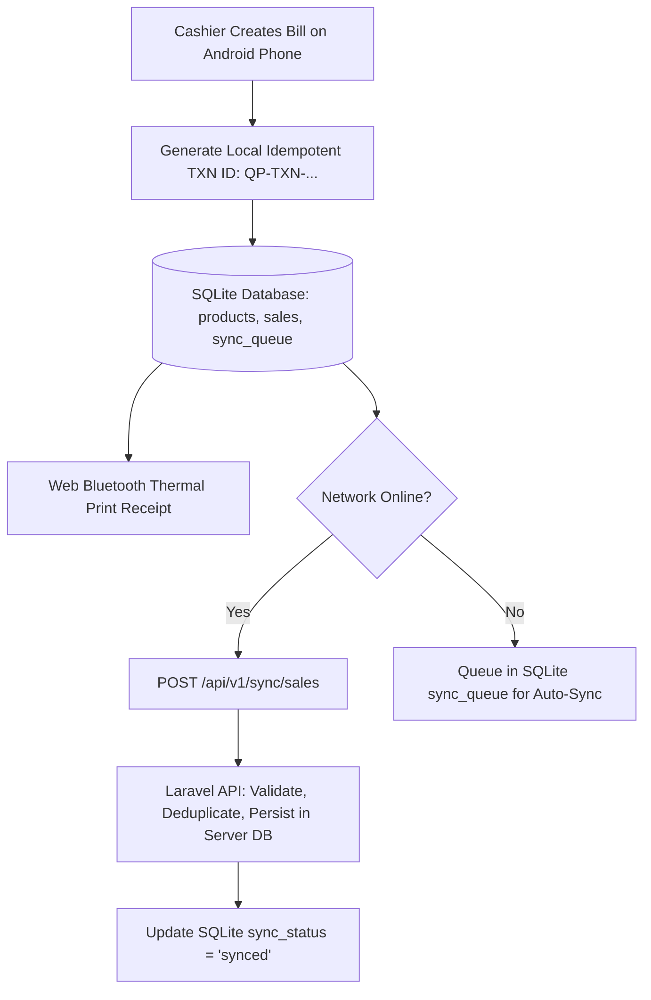

# QUICK-POS — SYSTEM ARCHITECTURE

## 1. High-Level Architecture Overview

Quick-POS is organized as a unified monorepo:

```
Quick-POS/
├── frontend/             # Next.js 14/15 PWA (TypeScript, Tailwind CSS, shadcn/ui, skiper-ui)
│   ├── src/
│   │   ├── app/          # App Router (Panel A: Super Admin, Panel B: POS, Panel C: Field Rep)
│   │   ├── components/   # UI primitives, animated links (skiper40), POS modules, virtual receipt
│   │   └── lib/          # Offline Dexie.js DB, Web Bluetooth ESC/POS engine, API client
├── backend/              # Laravel 11 REST API (Sanctum authentication, multi-tenant DB)
│   ├── app/              # Models, Controllers, Policies, Scopes, Services
│   ├── database/         # Migrations, Seeders
│   └── routes/           # API routes (v1)
└── docs/                 # Permanent specification and engineering documentation
```

## 2. Offline-First Billing Architecture (SQLite Engine)

Quick-POS uses an embedded **SQLite database** on client devices for offline billing, ensuring full ACID transaction integrity, relational joins, and persistent local storage even during network outages.



## 3. Bluetooth Thermal Printing Integration
- Protocol: ESC/POS (standard raw byte commands) over Web Bluetooth API `navigator.bluetooth`.
- Roll widths: 58mm (32 chars/line) and 80mm (48 chars/line).
- Capabilities: Text justification, bold emphasis, feed & cut, line divider, bilingual receipt headers, QR code rendering.
- Virtual Receipt Fallback: Rendered thermal paper preview on web UI when physical printer is not connected.
