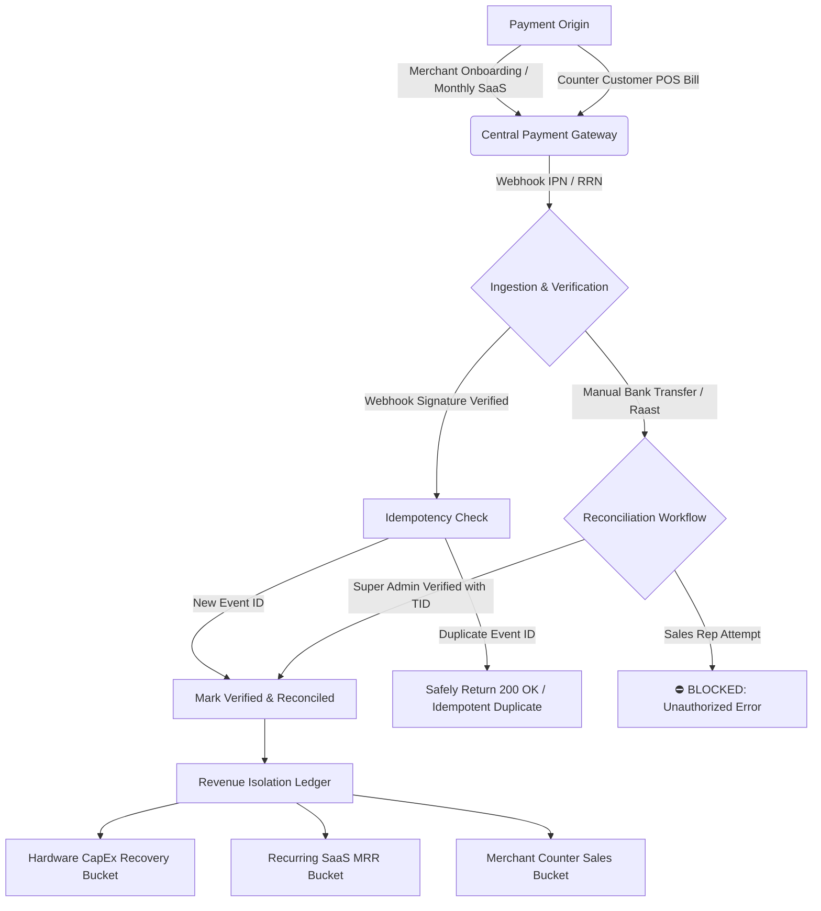

# Standard 12: Digital Payment Management & Reconciliation

## 1. Architectural Overview & Workflow

Quick-POS implements a centralized digital payment architecture designed specifically for Pakistani payment rails and wallet ecosystems (**JazzCash, EasyPaisa, Raast ID, 1Link / Meezan Bank**).

---

## 2. Core Payment Fields Tracked

Every digital payment transaction records:
1. **Tenant / Customer**: `tenantId`, `storeCode`, `storeName`, and optional `customerId`/`customerName`.
2. **Amount and Currency**: Exact monetary value in Pakistani Rupees (`PKR`).
3. **Payment Reference (TID / RRN)**: Mandatory bank or gateway transaction reference.
4. **Payment Purpose**:
   - `hardware_installment_1`: Upfront PKR 5,000 for printer & onboarding.
   - `hardware_installment_2`: PKR 6,000 final printer ownership settlement.
   - `subscription_monthly_saas`: PKR 1,000 / month recurring software license.
   - `enterprise_multi_counter`: PKR 2,500 / month enterprise multi-counter license.
   - `pos_counter_bill`: Retail customer checkout bill via Raast QR / mobile wallet.
5. **Payment Provider**: `jazzcash`, `easypaisa`, `raast`, `bank_transfer`, `cash`.
6. **Payment Status**: `pending`, `verified`, `failed`, `refunded`.
7. **Verification Timestamp**: Date-time when verification occurred.
8. **Verifier Information**: `verifiedByUid`, `verifiedByRole` (`super_admin` or `gateway_webhook`).
9. **Refund or Reversal Information**: `refundId`, `amountPkr`, `reason`, `reversedAt`, `reversedByUid`.

---

## 3. Strict Revenue Separation

> [!IMPORTANT]
> **Accounting Rule**: Hardware payments must be kept strictly separate from recurring subscription revenue.

The payment engine classifies revenue into distinct buckets:
- **Hardware CapEx Recovery (`hardware_capex`)**:
  - Installment 1 (PKR 5,000) & Installment 2 (PKR 6,000).
  - Used strictly for hardware inventory procurement, amortized delivery, and printer ownership transfer.
- **Recurring SaaS MRR (`recurring_saas`)**:
  - Standard Monthly Retail SaaS (PKR 1,000/mo) and Enterprise Multi-Counter (PKR 2,500/mo).
  - Tracked as pure Monthly Recurring Revenue (MRR) for software platform viability.
- **Merchant Counter Gross Sales (`merchant_gross_sales`)**:
  - Customer payments received at the POS register via Raast QR or mobile wallets.

---

## 4. Idempotent Gateway Webhook Ingestion

Repeated webhook deliveries from gateways (network retries, timeouts, or delayed ACK responses) are handled safely:
- Every webhook payload contains an `eventId` (or gateway transaction reference).
- The payment engine logs processed event IDs in an internal idempotency store.
- If a delivery arrives for an already processed event:
  - It safely returns `HTTP 200 OK` with `{ idempotent: true, status: "verified" }`.
  - It **never** duplicates revenue, creates redundant ledger entries, or double-extends subscriptions.

---

## 5. Anti-Fraud RBAC: Sales Representative Verification Guard

> [!CAUTION]
> **Anti-Fraud Security Policy**: Sales Representatives are **strictly forbidden** from manually marking payments as verified.

- **Risk Mitigated**: Eliminates collusion where field representatives could falsely confirm subscription fees without actual bank transfers.
- **Enforcement**:
  - `digitalPaymentEngine.verifyPayment` inspects `verifierInfo.role`.
  - If `role === "sales_rep"`, the transaction is immediately rejected with an `UNAUTHORIZED` error and logged in the security audit trail.
  - Only `super_admin` or automated gateway webhooks can reconcile transactions.

---

## 6. Refund and Reversal Lifecycle

Payments can be reversed through an audited reconciliation workflow:
- Transitions the status to `refunded`.
- Creates an immutable reversal log (`ReversalInfo`) capturing `refundId`, `amountPkr`, `reason`, `reversedAt`, and `reversedByUid`.
- Subsequent refund attempts on already refunded transactions are rejected.
- If a subscription payment is reversed, the corresponding tenant account status is automatically re-evaluated into grace or restricted mode.
