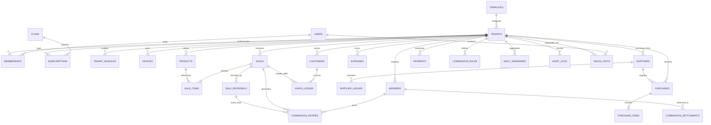
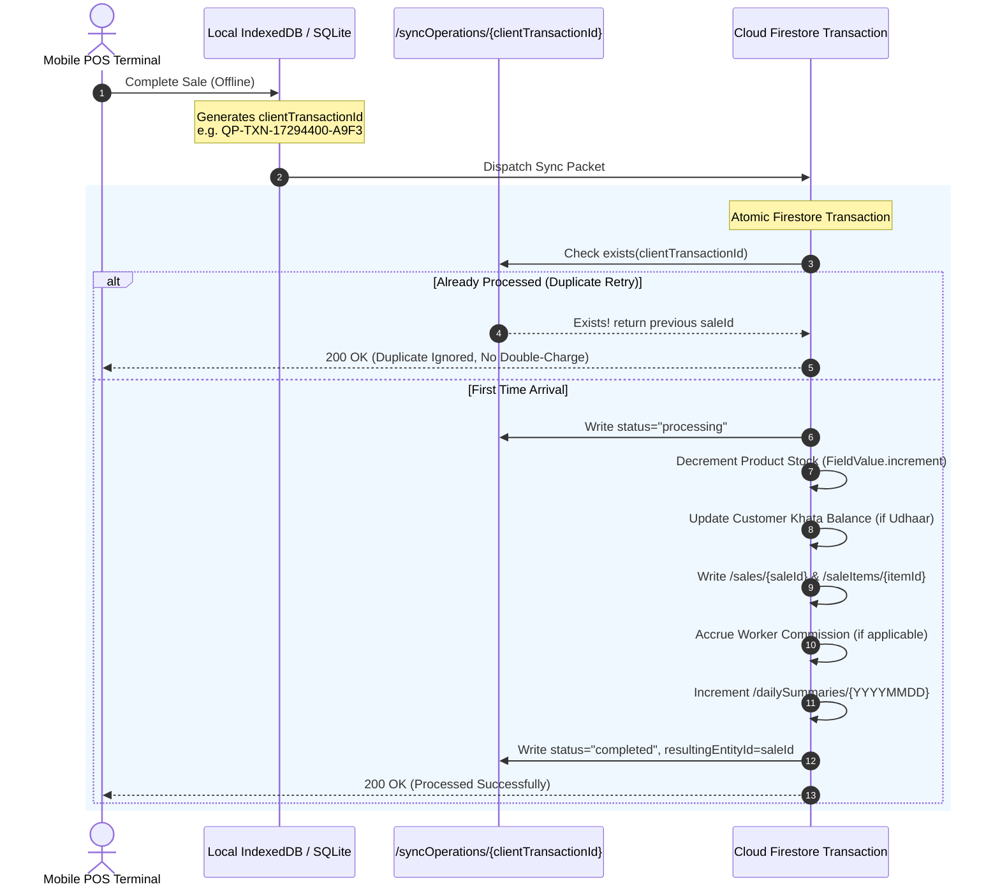

# QUICK-POS — CLOUD FIRESTORE DATA ARCHITECTURE & DESIGN
**Comprehensive Multi-Tenant Data Modeling, Security Rules, Immutability & High-Throughput Synchronization**

---

## 1. Executive Summary & Design Principles

Quick-POS uses **Google Cloud Firestore** as its primary cloud data store. In a multi-tenant retail SaaS serving diverse Pakistani retail verticals (Kiryana, Meat, Biryani/Food, Tailoring, Boutiques), data architecture directly determines system reliability, offline resilience, and operational cost.

### Core Architectural Mandates:
1. **Selective Collection Realization**: Treat the collection list as an initial design framework. Not all collections are created blindly; each schema, index, validation rule, and relationship is formally established before implementation.
2. **Zero-Trust Client Security**: Client applications (mobile POS, web POS, field rep apps) are untrusted runtimes. Payment status, financial totals, commission calculations, and subscription states are strictly verified or authored by server-side processes and Firestore Security Rules.
3. **Unbounded Document Elimination**: Firestore imposes a strict 1 MB per document limit. Unbounded arrays (e.g. sale items, Khata ledger logs, sync operation histories) are strictly modeled as subcollections with bounded summary counters updated via atomic increments (`FieldValue.increment()`).
4. **Immutable Financial Ledgers & Reversals**: Completed financial records (`sales`, `payments`, `commission_settlements`) are append-only. Adjustments, returns, or voided transactions are recorded via distinct **Reversal / Refund** documents referencing the parent transaction. Historical totals are never silently modified.
5. **Idempotent Synchronization**: Every financial and inventory transaction generates an immutable, client-assigned `clientTransactionId` (UUID v4 / nano-id) before hitting the network. Firestore transactions enforce deduplication to eliminate duplicate charges across unstable Pakistani cellular networks (2G/3G/4G).
6. **Read-Cost Optimization**: High-frequency queries (e.g. daily sales dashboard, customer Khata balances) utilize denormalized summary counters (`dailySummaries`, `currentBalance`) to eliminate full-collection scans.

---

## 2. Global Topology & Entity Hierarchy

Quick-POS uses a **Hybrid Multi-Tenant Firestore Topology**:
- **Global Root Collections**: For cross-tenant identities, SaaS plans, global business templates, field sales operations, and system-wide idempotency tracking.
- **Tenant Subcollections**: Housed under `/tenants/{tenantId}/...` to guarantee natural multi-tenant isolation, simplify Firestore security rules (`request.auth.uid in tenant memberships`), and prevent cross-tenant data leakage.

```
/ (Root)
│
├── /users/{userId}                           [Global User Accounts & Auth Profiles]
├── /plans/{planId}                           [SaaS Subscription Plans & Pricing]
├── /templates/{templateId}                   [Business Category Presets (Kiryana, Meat...)]
├── /salesVisits/{visitId}                    [Field Sales Rep Merchant Visits & Onboarding]
├── /syncOperations/{clientTransactionId}     [Global Idempotency & Dedup Registry]
│
└── /tenants/{tenantId}                       [Tenant / Shop Root Document]
    ├── /memberships/{memberId}               [Staff Roles, Terminal PINs & Permissions]
    ├── /tenantModules/{moduleId}             [Enabled Feature Toggles per Shop]
    ├── /devices/{deviceId}                   [Thermal Printers & Authorized Mobile Terminals]
    ├── /products/{productId}                 [Catalog, Barcodes, Cost & Stock Counters]
    ├── /sales/{saleId}                       [Finalized Orders & Invoices]
    │   ├── /saleItems/{itemId}               [Itemized Lines (Subcollection: Bound Guard)]
    │   └── /reversals/{reversalId}           [Immutable Returns, Voids & Refunds]
    ├── /purchases/{purchaseId}               [Wholesale Stock-In Invoices]
    │   └── /purchaseItems/{itemId}           [Itemized Purchase Lines]
    ├── /expenses/{expenseId}                 [Operating Costs: Rent, Tea, Fuel, Salary]
    ├── /customers/{customerId}               [Customer Profiles & Credit Limits]
    │   └── /khataLedger/{ledgerId}           [Immutable Udhaar Debits & Repayments]
    ├── /suppliers/{supplierId}               [Wholesalers & Accounts Payable]
    │   └── /supplierLedger/{ledgerId}        [Immutable Supplier Purchase/Pay Ledger]
    ├── /payments/{paymentId}                 [Multi-Channel Financial Receipts (Cash/JazzCash)]
    ├── /subscriptions/{subscriptionId}       [Shop SaaS Billing, Installments & Grace Dates]
    ├── /workers/{workerId}                   [Staff Roster, Payment Modes & Sales Targets]
    ├── /commissionRules/{ruleId}             [Mathematical Commission Rules]
    ├── /commissionEntries/{entryId}          [Accrued & Clawed-Back Commission Ledger]
    ├── /commissionSettlements/{settlementId} [Disbursed Commission Payout Vouchers]
    ├── /dailySummaries/{dateYYYYMMDD}        [Aggregated Financial Rollups (1-read reports)]
    └── /auditLogs/{logId}                    [Immutable Security Audit Trail]
```

---

## 3. Comprehensive Entity-Relationship Diagram (ERD)



---

## 4. Detailed Specification of the 21 Collections

### 4.1 `users` (Global Root Collection)
- **Path**: `/users/{userId}`
- **Purpose**: Global user identities authenticated via Firebase Auth (Phone / Email).
- **Access**: User read/write self; Super Admin full access.
- **Document Schema**:
  ```typescript
  interface UserDocument {
    uid: string;                       // Primary Key (matches Firebase Auth UID)
    fullName: string;                  // e.g. "Muhammad Tariq"
    phone: string;                     // e.g. "+923001234567" (E.164 format, Unique)
    email?: string;                    // Optional (e.g. "tariq@gmail.com")
    isSuperAdmin: boolean;             // Server-verified platform root admin
    assignedRole: "super_admin" | "sales_rep" | "merchant_user";
    status: "active" | "suspended";
    createdAt: Timestamp;
    updatedAt: Timestamp;
  }
  ```

---

### 4.2 `tenants` (Root Tenant Collection)
- **Path**: `/tenants/{tenantId}`
- **Purpose**: Represents an independent shop/business entity.
- **Access**: Read by tenant members, Field Reps, Super Admin; Created by Super Admin / Field Reps.
- **Document Schema**:
  ```typescript
  interface TenantDocument {
    tenantId: string;                  // PK (e.g. "MADINA-KIR", "ALMAKKAH-MEAT")
    businessName: string;              // e.g. "Madina Kiryana & General Store"
    slug: string;                      // Normalized unique slug: "madina-kiryana"
    ownerUid: string;                  // Global UID of primary owner
    ownerName: string;                 // Cached owner name
    ownerPhone: string;                // Primary Pakistani phone (+92 3XX XXXXXXX)
    area: string;                      // e.g. "Shah Faisal Colony # 2"
    city: string;                      // e.g. "Karachi", "Lahore", "Rawalpindi"
    address: string;                   // Physical store location
    templateId: "kiryana" | "meat" | "biryani" | "tailor" | "boutique" | "custom";
    status: "active" | "suspended" | "grace_period" | "trial";
    activePlanId: string;              // Reference to /plans/{planId}
    subscriptionStatus: "paid" | "due" | "overdue";
    nextDueDate: Timestamp;
    defaultPaperWidth: "58mm" | "80mm";
    printerMacAddress?: string;        // Default paired Bluetooth ESC/POS printer
    balanceCounters: {
      totalSalesCount: number;         // Atomic increment counter
      totalRevenuePkr: number;         // Total gross lifetime revenue
      totalUdhaarOutstandingPkr: number;// Active customer credit balance
    };
    createdAt: Timestamp;
    updatedAt: Timestamp;
  }
  ```

---

### 4.3 `memberships` (Tenant Subcollection)
- **Path**: `/tenants/{tenantId}/memberships/{userId}`
- **Purpose**: Role-Based Access Control (RBAC) linking a global User to a specific shop.
- **Access**: Read by shop staff; Written exclusively by Shop Owner or Super Admin.
- **Document Schema**:
  ```typescript
  interface MembershipDocument {
    userId: string;                    // PK (matches Firebase Auth UID)
    tenantId: string;                  // Enforces strict tenant scope
    role: "owner" | "manager" | "cashier" | "worker";
    pinHash: string;                   // Salted SHA-256 hash of 4-digit terminal cash PIN
    status: "active" | "suspended" | "revoked";
    permissions: Array<
      | "pos.bill"
      | "pos.discount"
      | "pos.price_override"
      | "pos.void"
      | "inventory.manage"
      | "khata.credit"
      | "khata.settle"
      | "expenses.record"
      | "reports.view"
      | "staff.commission_manage"
      | "tenant.settings"
    >;
    assignedWorkerId?: string;         // Optional FK linking to /workers/{workerId}
    joinedAt: Timestamp;
    lastActiveAt?: Timestamp;
  }
  ```

---

### 4.4 `products` (Tenant Subcollection)
- **Path**: `/tenants/{tenantId}/products/{productId}`
- **Purpose**: Product inventory catalog, pricing, barcodes, and real-time stock counters.
- **Access**: Read by all shop staff; Created/Updated by Manager or Owner; Cashier can update stock on sale.
- **Document Schema**:
  ```typescript
  interface ProductDocument {
    productId: string;                 // PK (UUID or Barcode)
    tenantId: string;
    barcode: string;                   // Scannable barcode or manual SKU (Indexed)
    name: string;                      // e.g. "Dal Chana Special", "Tapal Tea 450g"
    categoryName: string;              // e.g. "Pulses", "Tea", "Chicken", "Suiting"
    unit: "kg" | "gram" | "pao" | "pcs" | "packet" | "dozen" | "suit" | "plate" | "job";
    costPrice: number;                 // Wholesale cost in PKR (Protected from Cashiers)
    salePrice: number;                 // Selling retail price in PKR
    stockQuantity: number;             // Fractional decimal (e.g. 14.500 kg or 50 pcs)
    minStockAlert: number;             // Threshold for low stock notification
    imageUrl?: string;                 // Product preview photo
    isActive: boolean;
    pricingTierId?: string;            // Optional volume pricing
    updatedAt: Timestamp;
  }
  ```

---

### 4.5 `sales` & `saleItems` (Tenant Subcollection with Subcollection Child)
- **Path**: `/tenants/{tenantId}/sales/{saleId}`
- **Child Path**: `/tenants/{tenantId}/sales/{saleId}/saleItems/{itemId}`
- **Purpose**: Finalized checkout orders. Line items are placed in a subcollection to guarantee the parent document remains strictly bounded (< 1 KB) regardless of order size.
- **Document Schema (`sales`)**:
  ```typescript
  interface SaleDocument {
    saleId: string;                    // PK
    tenantId: string;
    clientTransactionId: string;       // Unique idempotent key (e.g. "QP-TXN-MADINA-...")
    invoiceNumber: string;             // Human-readable sequential invoice: "INV-202610-0042"
    customerId?: string;               // Optional FK to customer
    customerName?: string;             // Denormalized for zero-read receipt rendering
    cashierUid: string;                // Staff UID who created the sale
    cashierName: string;               // Denormalized
    workerId?: string;                 // Attributed commission worker
    itemCount: number;                 // Total distinct line items count
    totalQuantity: number;             // Sum of quantities sold
    subtotalPkr: number;               // Gross total before discount
    discountPkr: number;               // Manual or promo discount applied
    taxPkr: number;                    // General Sales Tax (if applicable)
    finalTotalPkr: number;             // Net receivable amount
    paymentMethod: "cash" | "jazzcash" | "easypaisa" | "raast" | "udhaar" | "card" | "split";
    amountPaidPkr: number;             // Amount tendered by customer
    changeReturnedPkr: number;         // Change given back in cash
    udhaarAmountPkr: number;           // Remaining credit balance booked to Khata
    paymentSplitBreakdown?: {
      cashPkr?: number;
      jazzcashPkr?: number;
      easypaisaPkr?: number;
      udhaarPkr?: number;
    };
    status: "completed" | "refunded" | "partially_refunded" | "voided";
    reversalId?: string;               // Linked if voided or refunded
    syncStatus: "synced" | "pending_sync" | "failed";
    createdAt: Timestamp;              // Immutable timestamp of creation
  }
  ```
- **Child Schema (`saleItems`)**:
  ```typescript
  interface SaleItemDocument {
    itemId: string;                    // PK
    saleId: string;                    // FK
    productId: string;                 // FK
    productName: string;
    unit: string;                      // "kg", "pcs", "pao"
    quantity: number;                  // e.g. 2.500
    unitCostPrice: number;             // Cost at time of sale (for margin audits)
    unitSalePrice: number;             // Selling price applied
    discountPkr: number;               // Line-level discount
    totalPkr: number;                  // (quantity * unitSalePrice) - discountPkr
  }
  ```

---

### 4.6 `purchases` & `purchaseItems` (Tenant Subcollection)
- **Path**: `/tenants/{tenantId}/purchases/{purchaseId}`
- **Child Path**: `/tenants/{tenantId}/purchases/{purchaseId}/purchaseItems/{itemId}`
- **Purpose**: Wholesale stock-in receipts from vendors.
- **Document Schema (`purchases`)**:
  ```typescript
  interface PurchaseDocument {
    purchaseId: string;                // PK
    tenantId: string;
    supplierId: string;                // FK to /suppliers/{supplierId}
    supplierName: string;
    vendorInvoiceNumber: string;       // Wholesale paper bill number
    totalBillPkr: number;              // Total wholesale cost
    paidAmountPkr: number;             // Paid immediately upon delivery
    balanceDuePkr: number;             // Added to accounts payable
    paymentMethod: "cash" | "bank_transfer" | "cheque" | "credit";
    receivedByUid: string;             // Staff UID
    status: "received" | "partial" | "returned";
    purchasedAt: Timestamp;
    createdAt: Timestamp;
  }
  ```

---

### 4.7 `payments` (Tenant Subcollection)
- **Path**: `/tenants/{tenantId}/payments/{paymentId}`
- **Purpose**: All standalone financial cashflow transactions (Customer Khata settlements, Supplier invoice payments, SaaS subscription installments).
- **Access**: Read by Manager/Owner; Created by Cashier/Manager; Immutable once recorded.
- **Document Schema**:
  ```typescript
  interface PaymentDocument {
    paymentId: string;                 // PK
    tenantId: string;
    clientTransactionId: string;       // Idempotency token
    paymentType: 
      | "customer_khata_settlement"
      | "supplier_invoice_payment"
      | "saas_onboarding_installment"
      | "saas_monthly_subscription"
      | "worker_advance";
    referenceEntityId: string;         // FK (customerId, supplierId, subscriptionId)
    referenceDocId?: string;           // Optional specific sale or invoice ID
    amountPkr: number;                 // Financial amount
    paymentMethod: "cash" | "jazzcash" | "easypaisa" | "raast" | "bank_transfer";
    transactionReference?: string;     // Electronic TID from JazzCash/EasyPaisa
    recordedByUid: string;
    notes?: string;
    createdAt: Timestamp;
  }
  ```

---

### 4.8 `expenses` (Tenant Subcollection)
- **Path**: `/tenants/{tenantId}/expenses/{expenseId}`
- **Purpose**: Operating overheads and petty cash expenditures.
- **Access**: Read by Manager/Owner; Created by Manager/Owner/Authorized Cashier.
- **Document Schema**:
  ```typescript
  interface ExpenseDocument {
    expenseId: string;                 // PK
    tenantId: string;
    category: 
      | "shop_rent"
      | "electricity"
      | "generator_fuel"
      | "tea_refreshments"
      | "transport_fare"
      | "packaging_bags"
      | "printer_paper_rolls"
      | "maintenance"
      | "staff_salary"
      | "miscellaneous";
    title: string;                     // e.g. "Generator Petrol 5 Litres"
    amountPkr: number;
    paymentMethod: "cash" | "jazzcash" | "easypaisa" | "bank";
    recordedByUid: string;
    expenseDate: string;               // "YYYY-MM-DD"
    receiptImageUrl?: string;          // Photo of paper receipt
    notes?: string;
    createdAt: Timestamp;
  }
  ```

---

### 4.9 `customers` & `khataLedger` (Tenant Subcollection)
- **Path**: `/tenants/{tenantId}/customers/{customerId}`
- **Child Path**: `/tenants/{tenantId}/customers/{customerId}/khataLedger/{ledgerId}`
- **Purpose**: Customer Udhaar profiles with strictly bounded parent summary counters and an append-only subcollection ledger.
- **Document Schema (`customers`)**:
  ```typescript
  interface CustomerDocument {
    customerId: string;                // PK (e.g. Phone number or UUID)
    tenantId: string;
    fullName: string;                  // e.g. "Chaudhry Akram"
    phone: string;                     // e.g. "03219876543"
    area: string;                      // e.g. "Street 4, Sector 5-B"
    creditLimitPkr: number;            // Hard ceiling for Udhaar (e.g. PKR 15,000)
    currentBalancePkr: number;         // Positive = Customer owes shop (Atomic increment)
    totalPurchasesLifetimePkr: number;
    totalRepaidLifetimePkr: number;
    isActive: boolean;
    lastTransactionAt: Timestamp;
    createdAt: Timestamp;
  }
  ```
- **Child Schema (`khataLedger`)**:
  ```typescript
  interface KhataLedgerDocument {
    ledgerId: string;                  // PK
    customerId: string;
    tenantId: string;
    entryType: "debit_sale" | "credit_repayment" | "credit_reversal" | "adjustment";
    amountPkr: number;
    saleId?: string;                   // Linked sale for debit entries
    paymentId?: string;                // Linked payment for repayment entries
    previousBalancePkr: number;        // Audit balance before entry
    newBalancePkr: number;             // Resulting balance
    notes?: string;
    recordedByUid: string;
    createdAt: Timestamp;              // Immutable
  }
  ```

---

### 4.10 `suppliers` & `supplierLedger` (Tenant Subcollection)
- **Path**: `/tenants/{tenantId}/suppliers/{supplierId}`
- **Child Path**: `/tenants/{tenantId}/suppliers/{supplierId}/supplierLedger/{ledgerId}`
- **Purpose**: Wholesale vendors, distributors, and payable accounts.
- **Document Schema (`suppliers`)**:
  ```typescript
  interface SupplierDocument {
    supplierId: string;                // PK
    tenantId: string;
    companyName: string;               // e.g. "Shan Foods Wholesale Karachi"
    contactPerson: string;             // e.g. "Kamran Bhai"
    phone: string;                     // e.g. "03001234987"
    area: string;                      // e.g. "Jodia Bazar, Karachi"
    currentPayableBalancePkr: number;  // Positive = Shop owes supplier (Atomic increment)
    isActive: boolean;
    createdAt: Timestamp;
  }
  ```

---

### 4.11 `subscriptions` (Tenant Subcollection)
- **Path**: `/tenants/{tenantId}/subscriptions/{subscriptionId}`
- **Purpose**: SaaS software license billing, hardware package installments, and grace periods.
- **Access**: Read by Shop Owner; Written **ONLY by Super Admin** or verified Server Webhooks.
- **Document Schema**:
  ```typescript
  interface SubscriptionDocument {
    subscriptionId: string;            // PK
    tenantId: string;
    planId: string;                    // Reference to /plans/{planId}
    planName: string;                  // e.g. "Shah Faisal Pilot Onboarding + Printer"
    hardwareIncluded: boolean;         // True if thermal printer bundled
    totalContractPkr: number;          // e.g. PKR 11,000
    installment1AmountPkr: number;     // e.g. PKR 5,000 (Upfront)
    installment1Paid: boolean;
    installment2AmountPkr: number;     // e.g. PKR 6,000 (Month 2)
    installment2Paid: boolean;
    monthlyRecurringPkr: number;       // e.g. PKR 1,000 / month thereafter
    status: "trial" | "active_paid" | "due" | "grace_period" | "suspended";
    currentPeriodStart: Timestamp;
    currentPeriodEnd: Timestamp;
    gracePeriodEndsAt: Timestamp;      // After this, POS switches to restricted mode
    lastPaymentDate?: Timestamp;
    lastPaymentAmountPkr?: number;
    verifiedBySuperAdminUid?: string;  // Root admin who confirmed cash/bank receipt
  }
  ```

---

### 4.12 `plans` (Global Root Collection)
- **Path**: `/plans/{planId}`
- **Purpose**: System-wide subscription tier definitions and pricing models.
- **Access**: Read by all authenticated users; Write by Super Admin only.
- **Document Schema**:
  ```typescript
  interface PlanDocument {
    planId: string;                    // PK (e.g. "pilot_shah_faisal_58mm", "standard_monthly")
    title: string;                     // "Pilot Bundle with 58mm Printer"
    description: string;
    upfrontInstallmentPkr: number;     // PKR 5,000
    secondInstallmentPkr: number;      // PKR 6,000
    monthlySaasPkr: number;            // PKR 1,000
    hardwareBundle: "none" | "printer_58mm" | "printer_80mm";
    maxProducts: number;               // e.g. 5000 or -1 (unlimited)
    maxDevices: number;                // e.g. 3
    features: string[];                // ["thermal_print", "khata", "commissions"]
    isActive: boolean;
  }
  ```

---

### 4.13 `templates` (Global Root Collection)
- **Path**: `/templates/{templateId}`
- **Purpose**: Business template definitions driving custom units, portion modes, and UI views.
- **Access**: Read by all; Write by Super Admin only.
- **Document Schema**:
  ```typescript
  interface TemplateDocument {
    templateId: "kiryana" | "meat" | "biryani" | "tailor" | "boutique" | "custom";
    displayName: string;               // e.g. "Kiryana & General Store"
    description: string;
    defaultUnits: string[];            // ["kg", "gram", "pao", "pcs", "packet", "dozen"]
    defaultCategories: string[];       // ["Daalein", "Ghee & Oil", "Spices", "Tea"]
    recommendedModules: string[];      // ["billing", "inventory", "khata_udhaar"]
    supportsWeightScale: boolean;      // True for Meat Shop
    supportsPortions: boolean;         // True for Biryani (half/full plate)
    supportsMeasurements: boolean;     // True for Tailor (kameez, shalwar specs)
  }
  ```

---

### 4.14 `tenantModules` (Tenant Subcollection)
- **Path**: `/tenants/{tenantId}/tenantModules/{moduleId}`
- **Purpose**: Feature flags per shop to enable/disable specific business features dynamically.
- **Access**: Read by shop members; Write by Shop Owner or Super Admin.
- **Document Schema**:
  ```typescript
  interface TenantModuleDocument {
    moduleId: string;                  // PK (e.g. "worker_commissions", "khata_udhaar")
    tenantId: string;
    isEnabled: boolean;
    configuredAt: Timestamp;
    updatedByUid: string;
  }
  ```

---

### 4.15 `devices` (Tenant Subcollection)
- **Path**: `/tenants/{tenantId}/devices/{deviceId}`
- **Purpose**: Hardware devices (Bluetooth thermal printers, mobile POS handsets).
- **Document Schema**:
  ```typescript
  interface DeviceDocument {
    deviceId: string;                  // PK (Hardware UUID or MAC hash)
    tenantId: string;
    deviceType: "bluetooth_printer" | "pos_smartphone" | "cash_drawer";
    modelName: string;                 // e.g. "MPT-II 58mm ESC/POS", "Redmi 9A"
    macAddress?: string;               // e.g. "66:32:81:4A:20:9C"
    paperWidth?: "58mm" | "80mm";
    isAuthorized: boolean;             // True if verified for store billing
    lastPairedAt: Timestamp;
  }
  ```

---

### 4.16 `syncOperations` (Global Root Collection)
- **Path**: `/syncOperations/{clientTransactionId}`
- **Purpose**: Global idempotency and deduplication engine. Ensures that retried sync packets from offline devices are never processed twice.
- **Document Schema**:
  ```typescript
  interface SyncOperationDocument {
    clientTransactionId: string;       // PK (e.g. "QP-TXN-MADINA-1729440000000-A9F3")
    tenantId: string;
    entityType: "sale" | "payment" | "expense" | "khata_entry" | "refund";
    resultingEntityId: string;         // e.g. "sale_12345"
    status: "processing" | "completed" | "rejected";
    deviceInfo: {
      deviceId: string;
      appVersion: string;
      offlineTimestamp: Timestamp;
    };
    processedAt: Timestamp;
  }
  ```

---

### 4.17 `auditLogs` (Tenant Subcollection — Strict Append-Only)
- **Path**: `/tenants/{tenantId}/auditLogs/{logId}`
- **Purpose**: Non-repudiation security audit trail of sensitive merchant operations.
- **Access**: Read by Shop Owner / Super Admin; Created by authenticated callers; Updates and Deletions permanently denied by Security Rules.
- **Document Schema**:
  ```typescript
  interface AuditLogDocument {
    logId: string;                     // PK (Autogenerated)
    tenantId: string;
    actorUid: string;                  // Staff UID
    actorName: string;
    action: 
      | "shop.login"
      | "shop.pin_reset"
      | "sale.completed"
      | "sale.voided"
      | "price.overridden"
      | "khata.credit_limit_changed"
      | "expense.recorded"
      | "commission.settled"
      | "device.paired"
      | "subscription.status_changed"
      | "shop.suspended";
    targetResource: string;            // "Sale/INV-202610-0042", "Customer/03219876543"
    metadata: Record<string, unknown>; // Snapshot of payload differences
    ipAddress?: string;
    timestamp: Timestamp;              // Server timestamp
  }
  ```

---

### 4.18 `salesVisits` (Global Root Collection)
- **Path**: `/salesVisits/{visitId}`
- **Purpose**: Tracks field sales representatives onboarding shops in local commercial markets.
- **Document Schema**:
  ```typescript
  interface SalesVisitDocument {
    visitId: string;                   // PK
    salesRepUid: string;               // Auth UID of Field Sales Rep
    salesRepName: string;
    merchantName: string;              // Shop owner visited
    shopName: string;
    marketArea: string;                // e.g. "Shah Faisal Colony # 3 Market"
    city: string;                      // "Karachi"
    phone: string;
    businessCategory: "kiryana" | "meat" | "biryani" | "tailor" | "other";
    outcome: "interested" | "demo_scheduled" | "onboarded_paid" | "rejected";
    onboardedTenantId?: string;        // Populated if tenant created
    printerDelivered: boolean;         // True if 58mm printer handed over
    collectedAmountPkr: number;        // Cash collected for Installment 1
    gpsCoordinates?: {
      latitude: number;
      longitude: number;
    };
    notes?: string;
    visitedAt: Timestamp;
  }
  ```

---

### 4.19 `workers` (Tenant Subcollection)
- **Path**: `/tenants/{tenantId}/workers/{workerId}`
- **Purpose**: Shop workforce, karigars, butchers, and sales personnel with commission structures.
- **Document Schema**:
  ```typescript
  interface WorkerDocument {
    workerId: string;                  // PK
    tenantId: string;
    fullName: string;                  // e.g. "Ustad Rasheed (Tailor Master)"
    phone: string;                     // e.g. "03123456789"
    designation: string;               // "Master Cutter", "Counter Sales", "Butcher"
    joiningDate: Timestamp;
    isActive: boolean;
    paymentType: "fixed_salary" | "commission_only" | "salary_plus_commission";
    baseSalaryPkr: number;             // Fixed monthly stipend (if any)
    defaultCommissionRuleId?: string;  // Reference to /commissionRules/{ruleId}
    monthlySalesTargetPkr: number;     // e.g. PKR 300,000 target
    financialCounters: {
      totalSalesGeneratedPkr: number;
      totalCommissionEarnedPkr: number;
      totalCommissionPaidPkr: number;
      currentPendingPayoutPkr: number; // Earned - Paid - Clawbacks
    };
    updatedAt: Timestamp;
  }
  ```

---

### 4.20 `commissionRules` (Tenant Subcollection)
- **Path**: `/tenants/{tenantId}/commissionRules/{ruleId}`
- **Purpose**: Mathematical commission logic and qualification policies.
- **Document Schema**:
  ```typescript
  interface CommissionRuleDocument {
    ruleId: string;                    // PK
    tenantId: string;
    name: string;                      // "5% High-Value Grocery Sale", "PKR 250 Per Suit"
    method: 
      | "percentage_of_sales"
      | "fixed_amount_per_sale"
      | "product_based"
      | "category_based"
      | "fixed_per_completed_order"
      | "target_bonus"
      | "multi_worker_split";
    rateValue: number;                 // e.g. 5.0 (for 5%) or 250 (for PKR 250)
    applicableCategory?: string;
    applicableProductId?: string;
    minimumOrderPkr?: number;
    policies: {
      deductDiscountsFirst: boolean;   // Calculate on (subtotal - discount)
      allowCreditSales: boolean;       // Accrue on Udhaar sales immediately
      autoClawbackOnRefund: boolean;   // Deduct if order is refunded
      splitEnabled: boolean;           // Allow multi-worker allocation
    };
    isActive: boolean;
  }
  ```

---

### 4.21 `commissionEntries` & `commissionSettlements` (Tenant Subcollections)
- **Path (`entries`)**: `/tenants/{tenantId}/commissionEntries/{entryId}`
- **Path (`settlements`)**: `/tenants/{tenantId}/commissionSettlements/{settlementId}`
- **Purpose**:
  - `commissionEntries`: Append-only commission ledger records created on sale or reversed on refund.
  - `commissionSettlements`: Immutable payout vouchers disbursing accumulated commission.
- **Document Schema (`commissionEntries`)**:
  ```typescript
  interface CommissionEntryDocument {
    entryId: string;                   // PK
    tenantId: string;
    workerId: string;                  // FK
    workerName: string;
    saleId: string;                    // FK
    originatingSaleInvoice: string;
    entryType: "earned" | "target_bonus" | "refund_clawback";
    earnedAmountPkr: number;           // Positive for earnings, Negative for clawbacks
    calculatedRateSnapshot: string;    // "5.0% on PKR 10,000"
    status: "accrued" | "locked_in_settlement" | "settled";
    settlementId?: string;             // FK to /commissionSettlements/{settlementId}
    accruedAt: Timestamp;
  }
  ```
- **Document Schema (`commissionSettlements`)**:
  ```typescript
  interface CommissionSettlementDocument {
    settlementId: string;              // PK
    tenantId: string;
    workerId: string;                  // FK
    workerName: string;
    voucherNumber: string;             // "VCH-202610-0012"
    periodStart: Timestamp;
    periodEnd: Timestamp;
    totalAmountPkr: number;            // Total paid out
    paymentMethod: "cash" | "jazzcash" | "easypaisa" | "bank_transfer";
    paymentReference?: string;
    disbursedByUid: string;            // Shop Owner UID
    coveredEntryIds: string[];         // Array of entry IDs locked and settled
    settledAt: Timestamp;
  }
  ```

---

## 5. Unbounded Document Prevention & Anti-Pattern Analysis

### Anti-Pattern 1: The Monolithic Customer Khata Array
```json
// DANGEROUS ANTI-PATTERN: DO NOT USE
{
  "customerId": "cust_123",
  "name": "Chaudhry Akram",
  "khataEntries": [
    { "date": "2026-01-01", "amount": 500, "type": "debit" },
    ... 2,000 entries across 12 months ...
  ]
}
```
**Why this fails in Firestore**:
1. Hits Firestore's 1 MB document size ceiling.
2. Every lookup of a customer at POS reads and downloads the full 2,000-entry history over cellular 3G, consuming megabytes of unnecessary bandwidth.
3. Multiple cashiers updating the array simultaneously trigger concurrency conflicts.

**The Solution**:
Parent document holds cached metrics:
```json
{
  "customerId": "cust_123",
  "currentBalancePkr": 14200,
  "creditLimitPkr": 25000,
  "lastTransactionAt": "2026-10-21T00:30:00Z"
}
```
Ledger entries live in `/customers/{customerId}/khataLedger/{ledgerId}` fetched via `orderBy("createdAt", "desc").limit(20)`.

---

### Anti-Pattern 2: The Giant Sale Items Array
For large purchases or tailoring orders with individual fabric measurements, embedding `items: [...]` in the `sales` document can bloat the document and complicates collection group queries (e.g. "How many kg of Dal Chana did we sell across all orders this month?").
- **Solution**: Use `/sales/{saleId}/saleItems/{itemId}` subcollection for line items while retaining bounded summary counters (`itemCount`, `totalQuantity`, `finalTotalPkr`) on `/sales/{saleId}`.

---

### Anti-Pattern 3: Massive Daily Report Scans
Querying 2,500 individual sale documents to calculate today's total revenue costs 2,500 document reads.
- **Solution**: Implement `/tenants/{tenantId}/dailySummaries/{YYYY-MM-DD}`. During each sale transaction, atomically increment `totalRevenuePkr`, `cashCollectedPkr`, and `orderCount`. The dashboard reads **1 document**.

---

## 6. Financial Immutability & Reversal Workflow

### The Inviolable Rule:
> **Financial transactions once completed are NEVER edited or silently updated.**

When an order is voided or items returned:
1. A **`SaleReversalDocument`** is written to `/tenants/{tenantId}/sales/{saleId}/reversals/{reversalId}`:
   ```typescript
   interface SaleReversalDocument {
     reversalId: string;
     saleId: string;
     tenantId: string;
     reversalType: "full_refund" | "partial_return" | "void_mistake";
     refundAmountPkr: number;
     refundMethod: "cash" | "khata_credit";
     returnedItems: Array<{
       productId: string;
       quantityReturned: number;
       restockInventory: boolean;
     }>;
     reason: string;
     authorizedByUid: string;         // Manager or Owner UID
     createdAt: Timestamp;
   }
   ```
2. **Stock Restoration**: For each restocked item, `stockQuantity` is incremented by `+quantityReturned` using `FieldValue.increment()`.
3. **Khata Adjustment**: If the sale was originally Udhaar, a `credit_reversal` entry is written to `/customers/{customerId}/khataLedger` reducing the debt.
4. **Commission Clawback**: If commission was accrued for this sale, a negative entry is recorded in `/commissionEntries`:
   ```json
   {
     "entryType": "refund_clawback",
     "earnedAmountPkr": -250,
     "saleId": "sale_123",
     "workerId": "worker_456"
   }
   ```
5. **Sale Status**: The original sale status transitions to `"refunded"` or `"partially_refunded"`.

---

## 7. Safe, Idempotent Synchronization & Transaction Engine

### The Offline Retry Challenge:
In Pakistani retail markets, a 3G/4G network connection can drop immediately after a sale is dispatched but before the HTTP 200 response reaches the phone. The offline engine will re-send the packet when connectivity resumes.



---

## 8. Zero-Trust Access Control & Security Rules Architecture

### 8.1 Key Security Boundaries:
1. **Subscription Status Lockdown**: Non-super-admins cannot alter `status`, `planId`, or `gracePeriodEndsAt` in `/subscriptions` or `/tenants`.
2. **Pricing Overrides**: Cashiers cannot alter base `costPrice` or `salePrice` in `/products`.
3. **Audit Log Permanence**: `/auditLogs` rejects all `update` and `delete` requests permanently.
4. **Tenant Isolation**: Every write verifies that `request.resource.data.tenantId == tenantId` matching the Firestore document path.

---

## 9. Composite & Collection Group Indexes Plan (`firestore.indexes.json`)

To support fast reporting, worker commissions, and tenant queries without table scans:

| Collection / Subcollection | Fields Indexed | Query Type | Business Purpose |
|---|---|---|---|
| `sales` | `tenantId ASC`, `createdAt DESC` | Collection Query | Recent sales list in POS terminal |
| `sales` | `tenantId ASC`, `customerId ASC`, `createdAt DESC` | Collection Query | Customer purchase history |
| `sales` | `tenantId ASC`, `workerId ASC`, `createdAt DESC` | Collection Query | Worker sales performance tracking |
| `products` | `tenantId ASC`, `categoryName ASC`, `name ASC` | Collection Query | Categorized catalog browsing |
| `products` | `tenantId ASC`, `barcode ASC` | Collection Query | Instant barcode lookups |
| `khataLedger` | `customerId ASC`, `createdAt DESC` | Subcollection Query | Customer Khata ledger statement |
| `commissionEntries` | `tenantId ASC`, `workerId ASC`, `status ASC`, `accruedAt DESC` | Collection Query | Unsettled commissions calculation |
| `dailySummaries` | `tenantId ASC`, `date ASC` | Collection Query | Monthly financial trend graph |
| `salesVisits` | `salesRepUid ASC`, `visitedAt DESC` | Global Collection | Sales representative daily progress |
| `sales` (Collection Group) | `tenantId ASC`, `syncStatus ASC` | Collection Group | Background sync reconciliation worker |
