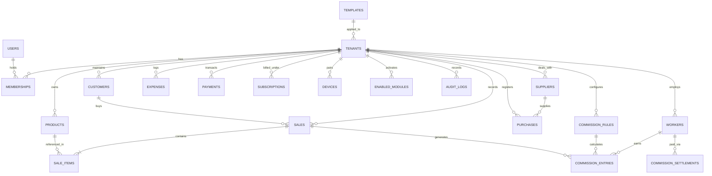

# QUICK-POS — MULTI-TENANT ARCHITECTURE SPECIFICATION
**Standard 5: Multi-Tenant Architecture, Entity Relationships & Server-Side Tenant Isolation**

---

## 1. Architectural Philosophy & Isolation Guarantees

Quick-POS is a **strict multi-tenant SaaS application**. Every registered Pakistani merchant shop operates as an independent tenant. 

### Core Security Tenets:
1. **Zero Trust Client-Side:** Frontend route hiding, UI state toggles, and client-side guards are strictly presentation layers. They are **never** treated as security boundaries.
2. **Explicit Tenant Scoping:** Every shop-owned record in both the relational database (PostgreSQL/MySQL) and document stores (Firestore) carries a non-forgeable, indexed `tenantId` (or `tenant_id`).
3. **Prevention of Cross-Tenant ID Tampering:** A user can never access, read, update, or delete another shop's records by tampering with URL parameters, query parameters, document IDs, or JSON payloads.
4. **Server-Side RBAC Enforcement:** Sensitive operations (financial ledger changes, refund voids, expense entries, staff commission payouts, store credential resets) are strictly authorized on the server based on verified tenant memberships and roles.

---

## 2. The 20 Core Multi-Tenant Entities & Relationships

The following 20 entities constitute the complete business and operational domain of Quick-POS:

| # | Entity | Relationship to Tenant | Cardinality | Primary Purpose |
|---|---|---|---|---|
| 1 | **Users** (`users`) | Global / Multi-Shop | $1 : N$ (via Memberships) | User identities (Owner, Cashier, Sales Rep, Super Admin) |
| 2 | **Shops / Tenants** (`shops` / `tenants`) | Root Tenant Entity | $1 : 1$ Tenant Boundary | Independent retail business instance |
| 3 | **Memberships & Roles** (`memberships`) | Tenant-Scoped Join | $N : M$ (User $\leftrightarrow$ Tenant) | RBAC role, permissions, and 4-digit terminal PIN |
| 4 | **Products** (`products`) | Tenant-Owned | $N : 1$ to Tenant | Inventory catalog, barcodes, prices, stock levels |
| 5 | **Sales** (`sales`) | Tenant-Owned | $N : 1$ to Tenant | Finalized customer billing orders with offline UUIDs |
| 6 | **Sale Items** (`sale_items`) | Child of Sale | $N : 1$ to Sale, $N : 1$ to Tenant | Itemized order lines with cost and sale pricing |
| 7 | **Purchases** (`purchases`) | Tenant-Owned | $N : 1$ to Tenant | Stock-in invoices from wholesale vendors |
| 8 | **Expenses** (`expenses`) | Tenant-Owned | $N : 1$ to Tenant | Operating expenses (Rent, Electricity, Tea, Fuel) |
| 9 | **Customers** (`customers`) | Tenant-Owned | $N : 1$ to Tenant | Customer Khata / Udhaar credit profiles and limits |
| 10 | **Suppliers** (`suppliers`) | Tenant-Owned | $N : 1$ to Tenant | Wholesale vendor contacts and payable balances |
| 11 | **Payments** (`payments`) | Tenant-Owned | $N : 1$ to Tenant | Financial cashflow transactions (Khata, Vendor, SaaS) |
| 12 | **Subscriptions** (`subscriptions`) | Tenant-Owned | $N : 1$ to Tenant | SaaS license status, package installments, grace dates |
| 13 | **Workers** (`workers`) | Tenant-Owned | $N : 1$ to Tenant | Store staff, karigars, salesmen, and cashiers |
| 14 | **Commission Rules** (`commission_rules`) | Tenant-Owned | $N : 1$ to Tenant | Mathematical rules (% of sale, fixed per suit, tiers) |
| 15 | **Commission Entries** (`commission_entries`) | Child of Worker/Sale | $N : 1$ to Worker & Tenant | Earned commission ledger entries linked to sales |
| 16 | **Commission Settlements** (`commission_settlements`) | Tenant-Owned | $N : 1$ to Worker & Tenant | Payout disbursements with signed digital receipt |
| 17 | **Devices** (`devices`) | Tenant-Owned | $N : 1$ to Tenant | Bluetooth thermal printers (MAC address) & POS phones |
| 18 | **Templates** (`templates`) | Global Reference | $1 : N$ to Tenants | Industry templates (Kiryana, Meat, Biryani, Tailor) |
| 19 | **Enabled Modules** (`enabled_modules`) | Tenant-Owned | $N : 1$ to Tenant | Active feature flags (Khata, Thermal, Commissions) |
| 20 | **Audit Logs** (`audit_logs`) | Tenant-Owned (Append-Only) | $N : 1$ to Tenant | Immutable security ledger of all sensitive operations |

---

## 3. Entity Relationship Diagram (ERD)

---

## 4. Multi-Tenant Role-Based Access Control (RBAC) Matrix

| Operation / Area | Super Admin | Shop Owner | Shop Manager | Cashier | Worker | Field Sales Rep |
|---|:---:|:---:|:---:|:---:|:---:|:---:|
| **Platform Management (`/admin`)** | Full | Denied | Denied | Denied | Denied | Lead Only |
| **Shop Settings & PIN Reset** | Full | Self Tenant | Denied | Denied | Denied | Denied |
| **Product Pricing Overrides** | Full | Self Tenant | Self Tenant | Denied | Denied | Denied |
| **Create & Finalize Sales** | Full | Self Tenant | Self Tenant | Self Tenant | Denied | Denied |
| **Udhaar / Khata Adjustment** | Full | Self Tenant | Self Tenant | Read/Write Limit | Denied | Denied |
| **Record Shop Expenses** | Full | Self Tenant | Self Tenant | Denied | Denied | Denied |
| **Worker Commission Payout** | Full | Self Tenant | Denied | Denied | View Own | Denied |
| **View Financial Reports & Audit** | Full | Self Tenant | Daily Only | Shift Only | Denied | Denied |

---

## 5. Security Implementation Layers

### Layer A: Firestore Security Rules (`firestore.rules`)
- All collections under `/tenants/{tenantId}` are guarded by `hasTenantAccess(tenantId)` and `hasTenantRole(tenantId, allowedRoles)`.
- Write payloads require `request.resource.data.tenantId == tenantId` to eliminate injection of mismatched tenant keys.
- Immutable collections (`audit_logs`) deny updates and deletions permanently.
- Cross-tenant queries are blocked because security rules filter at the document matching boundary.

### Layer B: Laravel API Global Scopes & Middleware
- **`TenantMiddleware`:** Extracts validated `tenant_id` from the Sanctum bearer token and sets it on the request context.
- **`TenantScope`:** Eloquent global scope automatically appends `WHERE tenant_id = ?` to all model reads, writes, updates, and deletes.
- **Idempotency:** Unique composite index on `(tenant_id, client_transaction_id)` prevents network retry duplicates.

### Layer C: Offline Client Storage (SQLite / Dexie)
- Client-side SQLite partition: every database query filters strictly by active store session `store_code` / `tenant_id`.
- Terminal switching clears cashier session keys and re-verifies PIN against the target tenant.
