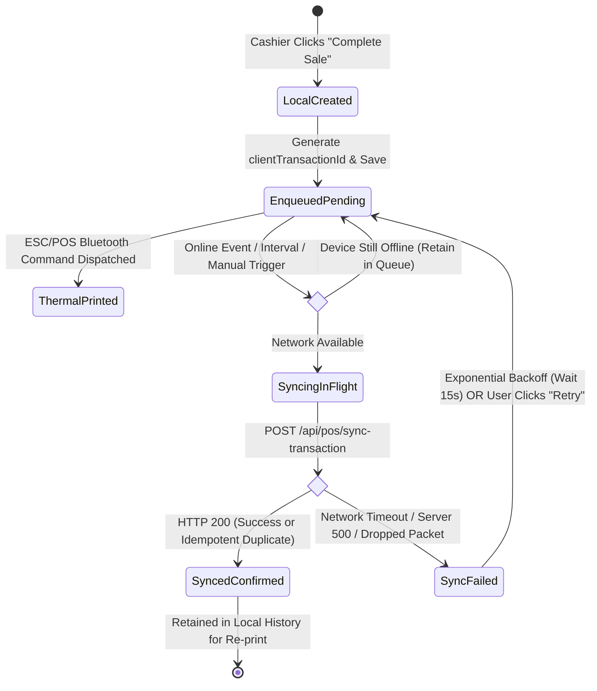

# QUICK-POS — OFFLINE-FIRST ARCHITECTURE & TRANSACTION QUEUE SPECIFICATION
**Standard 9: High-Reliability Local Billing, Idempotent Cloud Synchronization, and Failure Resilience**

---

## 1. Executive Summary & Philosophy

In Pakistani retail environments (Kiryana stores in Shah Faisal Town, meat shops in Liaquatabad, food stalls in Burns Road, suiting tailors in Saddar), **uninterrupted billing is mandatory**. Retailers face:
1. Frequent cellular network dropouts (2G/3G/4G handover loss, basement dead zones).
2. Daily electricity load shedding causing sudden Wi-Fi router restarts.
3. Smartphone battery depletion or accidental app closure during customer queues.

**The Golden Law of Quick-POS**:
> **A customer at the counter must NEVER be made to wait for an internet connection. Every sale, invoice number, and thermal receipt must be created and printed locally in under 300 milliseconds, with 100% durable persistence and zero chance of duplicate cloud billing.**

---

## 2. Why Firestore's Built-In Cache is Insufficient

While Google Cloud Firestore provides client-side offline persistence, relying on it alone for point-of-sale checkout introduces critical operational liabilities:

| Operational Requirement | Firestore Built-in Offline Cache | Quick-POS Durable Queue (`offlineSyncEngine`) |
|---|---|---|
| **Deterministic Unique Receipt ID** | Generates temporary local IDs that change or reconcile asynchronously | Assigns a permanent, immutable `clientTransactionId` (e.g. `QP-TXN-MADINA-...`) immediately |
| **Visible Sync State per Invoice** | Opaque `hasPendingWrites` boolean on document snapshots | Explicit `pending`, `syncing`, `synced`, `failed` states per invoice with live badges |
| **Duplicate Retry Prevention** | Retries blindly on connection; can double-bill if server triggers custom webhooks | Idempotency registry (`/syncOperations/{clientTransactionId}`) guarantees single processing |
| **Cashier Queue Inspection & Logs** | Invisible to cashier UI; cannot view why a sync failed | Full UI drawer showing attempt counts, timestamps, HTTP status codes, and error messages |
| **Manual User-Triggered Sync** | No manual flush API; depends on SDK internal timer | Prominent "Sync Now" button allowing cashiers to flush the queue on demand |
| **Local Retention for Re-printing** | May evict old documents under cache LRU pressure | Durable local ledger retains completed sales locally so receipts can be reprinted anytime |
| **Primary Device Concurrency Guard** | Allows any connected device to write conflicting documents | Restricts offline checkout to the shop's authorized primary POS terminal |

---

## 3. The 4-Tier Offline Architecture

```
┌────────────────────────────────────────────────────────────────────────┐
│                        TIER 1: LOCAL POS RUNTIME                       │
│  - Instant UI Rendering (< 16ms)        - Barcode Scanning             │
│  - Offline Cart & Bill Calculations     - Bluetooth ESC/POS Printing   │
└───────────────────────────────────┬────────────────────────────────────┘
                                    │ Creates Sale
                                    ▼
┌────────────────────────────────────────────────────────────────────────┐
│                 TIER 2: DURABLE LOCAL TRANSACTION QUEUE                │
│  - Stable clientTransactionId           - Complete Payload & Items     │
│  - Local Inventory Decrement            - Persistent Queue (Survives   │
│  - Status: 'pending'                    App Closure / Device Reboot)   │
└───────────────────────────────────┬────────────────────────────────────┘
                                    │
                                    ├─── [Offline] ──► Queue Retains Sale
                                    │
                                    ▼ [Online or 'Sync Now']
┌────────────────────────────────────────────────────────────────────────┐
│                   TIER 3: SYNC STATE MACHINE WORKER                    │
│  - Network Listeners (online/offline)   - Exponential Backoff & Jitter │
│  - Status: 'syncing'                    - Detailed Sync Logs Per Item  │
└───────────────────────────────────┬────────────────────────────────────┘
                                    │ HTTPS POST /api/pos/sync-transaction
                                    ▼
┌────────────────────────────────────────────────────────────────────────┐
│               TIER 4: SERVER IDEMPOTENT TRANSACTION ENGINE             │
│  - Check /syncOperations/{id}           - Atomic Cloud Stock Decrement │
│  - Customer Khata Debit                 - Worker Commission Accrual    │
│  - Write /sales & /saleItems            - 1-Read Daily Summary Rollup  │
│  - Return ACK (isDuplicate: bool)       - Update Local Status: 'synced'│
└────────────────────────────────────────────────────────────────────────┘
```

---

## 4. Synchronization State Machine & Lifecycle

Every sale generated on the POS terminal transitions through an explicit, deterministic state machine:



### State Definitions:
1. **`pending`**: The sale has been finalized, bill calculated, and receipt printed locally. It is durably persisted on disk and awaits network connectivity.
2. **`syncing`**: The sync packet is in-flight to the cloud API. Any concurrent sync worker ignores this item to prevent duplicate requests.
3. **`synced`**: The cloud Firestore server has confirmed processing and returned the permanent `saleId`. The local record is updated with `syncedAt` and preserved for local cashier history.
4. **`failed`**: The network dropped mid-flight, timed out, or returned an error. The item logs the exact error details and schedules an automatic retry.

---

## 5. Conflict Resolution & Reconciliation Policies

When a merchant operates offline for several hours, discrepancies can arise between local and cloud state. Quick-POS handles these conflicts through explicit business rules:

### Conflict A: Product Stock Divergence
- **Scenario**: Product stock on the server is 5 kg, but the cashier sells 8 kg while offline.
- **Resolution**:
  - The server **NEVER rejects a finalized customer financial transaction**. The customer has already paid and walked out with the goods.
  - The server updates `stockQuantity = FieldValue.increment(-8)`, allowing stock to reflect `-3 kg`.
  - An audit log warning is written: `"INVENTORY_NEGATIVE_STOCK_WARNING"`.
  - The store manager receives a dashboard alert to record a wholesale consignment or reconcile stock.

### Conflict B: Customer Udhaar Credit Limit Exceeded
- **Scenario**: A customer had PKR 1,000 remaining credit limit, but bought PKR 2,500 of groceries on credit while offline.
- **Resolution**:
  - The server accepts the Udhaar transaction and updates `currentBalancePkr = FieldValue.increment(2500)`.
  - The customer's balance now exceeds their credit limit (PKR 16,500 / PKR 15,000).
  - An audit log entry is recorded: `"KHATA_CREDIT_CEILING_BREACHED_OFFLINE"`.
  - Future credit sales for this customer are blocked once the terminal comes online.

### Conflict C: Price Overrides While Offline
- **Scenario**: Store owner updated a product's price on the Admin panel from PKR 100 to PKR 120, but the offline cashier sold it at PKR 100.
- **Resolution**:
  - The sale is accepted at the offline agreed rate (PKR 100). The customer invoice is a legal contract and cannot be retroactively increased.
  - Upon sync, the terminal automatically updates its local product catalog with the new PKR 120 price for future sales.

---

## 6. Primary POS Device Scoping (MVP Protection)

To prevent split-brain inventory racing across multiple smartphones before cloud reconciliation:
1. **Single Primary Terminal**: Each retail store designates exactly **one active primary POS handset** (identified by `QP-DEV-PRIMARY-...`).
2. **Device Registration**: The primary device token is persisted locally and passed with every sync payload (`isPrimaryDevice: true`).
3. **Secondary Devices (View-Only / Sales Rep)**: Secondary devices operate in read-only or order-booking mode, ensuring all cash drawer calculations remain serialized.

---

## 7. Testing & Failure Scenarios Handled

| Failure Scenario | Real-World Trigger | Engine Mitigation & Behavior |
|---|---|---|
| **Sudden Network Drop** | Cashier completes sale in a basement market with no cellular signal | Sale commits to local queue in < 5ms; Bluetooth printer prints receipt instantly; status set to `pending`. |
| **Packet Lost Mid-Sync** | Server receives sale and commits it, but cellular connection drops before HTTP 200 reaches the phone | The phone marks it `failed` and retries later. Server's `/syncOperations/{clientTransactionId}` detects duplicate, returns existing `saleId` without double-decrementing stock. |
| **App Termination / Phone Reboot** | Battery runs out immediately after billing | Queue is persisted in local durable storage. When phone reboots and app opens, sync worker resumes all pending items automatically. |
| **Tab / Browser Refresh** | Cashier reloads the POS webpage | State re-hydrates instantly from local queue; pending items badge and sync logs remain intact. |
| **Flaky Unstable Internet** | Rapid switching between Wi-Fi and 4G | Engine uses debounced online event listeners and individual item locks (`syncing`) to prevent parallel duplicate calls. |
