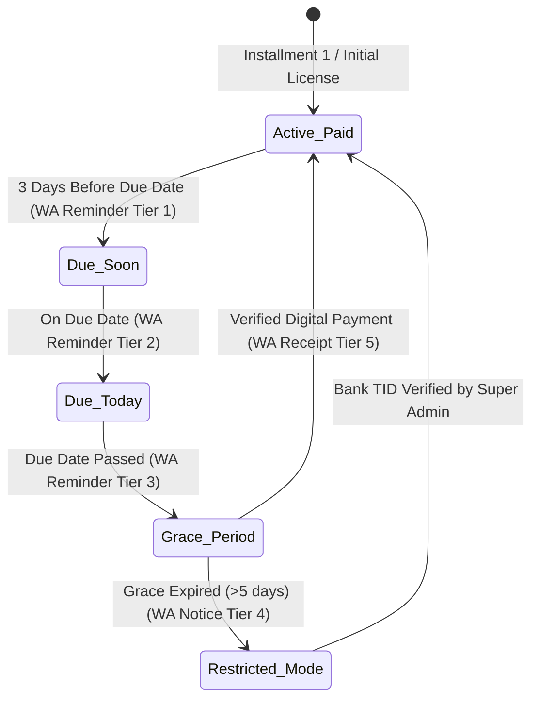

# Standard 11: Subscriptions and Automated Reminders

## 1. Architectural Overview & Business Model

Quick-POS implements a multi-tenant subscription engine engineered specifically for Pakistani micro-merchants, retail shops, and multi-counter outlets (Shah Faisal Town pilot). It adheres to local cashflow dynamics, where automatic recurring bank mandates (SEPA/Stripe) are not universally available across Pakistani digital wallets (EasyPaisa, JazzCash, Raast, 1Link).



---

## 2. Subscription Lifecycle & Configurable Policies

### 2.1 Core Subscription Fields Tracked
Each tenant subscription record tracks:
1. **Tenant ID & Store Code**: Isolated per merchant profile (`MADINA-KIR`, `ALMAKKAH-MEAT`, `KARACHI-BIRY`).
2. **Plan**: Configurable retail SaaS plan (Onboarding Package, Monthly SaaS, Enterprise Multi-Counter).
3. **Start Date & Next Due Date**: Normalized date strings for cycle tracking.
4. **Payment Status**: `paid`, `due`, `grace_period`, `restricted`, `suspended`.
5. **Grace Period**: Configurable grace window (default: 5 calendar days).
6. **Safe Offline Grace Policy**: Maximum authorized disconnected runtime (default: 7 days) without remote license invalidation.
7. **Renewal History**: Ledger of billing cycles, start/end dates, amounts, and settlement statuses.
8. **Activation / Restriction Status**: Immediate locking of new bill creation and thermal receipt printing when restricted.
9. **Verified Payments**: Immutable audit log of confirmed digital transactions (amount, method, transaction ID, admin verifier UID, timestamp).

### 2.2 Available Plans
| Plan Name | Upfront (PKR) | Month 2 (PKR) | Monthly SaaS (PKR) | Hardware | Grace Period |
| :--- | :--- | :--- | :--- | :--- | :--- |
| **Shah Faisal Onboarding Package** | 5,000 | 6,000 | 1,000 | 58mm Thermal Printer + Setup | 5 Days |
| **Standard Retail SaaS** | 0 | 0 | 1,000 | Cloud License & Unlimited Billing | 5 Days |
| **Enterprise Multi-Counter Plan** | 0 | 0 | 2,500 | Multi-Register + Commission Settler | 7 Days |

---

## 3. Automated 5-Tier WhatsApp Reminder Schedule

All reminder messages are generated in both **Urdu** (primary commercial language in Karachi retail) and English, supporting both **WhatsApp Direct Link (`wa.me`)** and **Meta Cloud API template payloads**:

```
1. 3 Days Before Due Date
   ├── Tier: DUE_IN_3_DAYS
   └── Focus: Friendly reminder with payment amount and Raast/EasyPaisa/JazzCash details.

2. On Due Date
   ├── Tier: DUE_TODAY
   └── Focus: Polite reminder highlighting uninterrupted billing continuity.

3. During Grace Period
   ├── Tier: IN_GRACE_PERIOD
   └── Focus: Urgent notice of active 5-day grace window and impending terminal restrictions.

4. Grace Period Expired
   ├── Tier: GRACE_EXPIRED_RESTRICTED
   └── Focus: Formal notice that terminal has entered Read-Only Mode (new billing & printing disabled).

5. Payment Verified & Reactivated
   ├── Tier: PAYMENT_VERIFIED_REACTIVATED
   └── Focus: Immediate reactivation confirmation receipt with next cycle due date.
```

---

## 4. Restriction Policy & Safe Offline Grace Rules

### 4.1 Read-Only Restricted Mode
When an account exceeds its configured grace period without verified payment:
- **New Billing Disabled**: Cashiers cannot finalize sales or checkout carts.
- **Thermal Printing Disabled**: ESC/POS receipt generation is blocked per policy.
- **Data Protection**: Existing sale records, khata (udhaar) ledgers, and inventory remain readable.
- **Account Recovery Banner**: Prominently displays official payment accounts (JazzCash Till, EasyPaisa, Raast ID, Meezan Bank IBAN) with 1-click WhatsApp verification submission.

### 4.2 Safe Offline Grace Policy
Offline devices cannot receive immediate remote restrictions:
- Devices maintain a **7-Day Offline Safety Window** from the `lastServerSyncAt` timestamp.
- Within 7 days: Merchant may continue local sales and queue transactions durably.
- Exceeding 7 days: Device demands reconnect to sync license credentials before resuming sales.
- Upon reconnect: POS automatically pulls the latest subscription state and enforces restrictions if overdue.

---

## 5. Zero-Trust Payment Reconciliation

> [!CAUTION]
> **Anti-Fraud Security Policy**: Reactivating subscriptions solely from payment screenshots is **strictly prohibited**. Image screenshots can be fabricated or recycled.

Super Admins must confirm the official **Transaction Reference ID (TID)** in their banking/wallet portal before clicking *Verify & Reactivate*:
- Requires JazzCash TID, EasyPaisa Transaction ID, Raast Reference Number, or Bank IBAN statement code.
- Blank or whitespace reference entries are hard-rejected by `subscriptionEngine.verifyPaymentAndReactivate`.
- Every verification logs the Super Admin's ID and timestamp permanently in the tenant's payment ledger.
